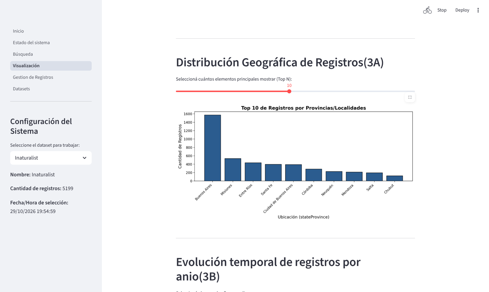
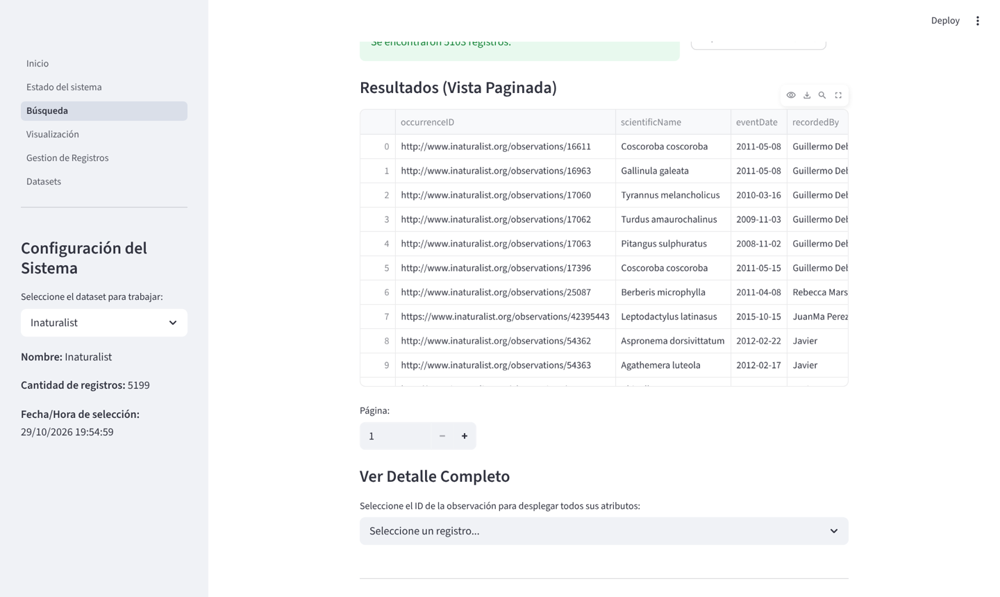

# Gestión de Biodiversidad · Darwin Core

Aplicación en **Python + Streamlit** para validar, explorar y visualizar datos reales de biodiversidad publicados bajo el estándar **Darwin Core (DwC)**.

Trabajo Integrador de **Taller de Lenguajes (Seminario de Lenguajes – Opción Python) 2026**, Licenciatura en Ciencia de Datos en Organizaciones, UNLP. Grupo 47.




## Integrantes

* **Bellocq Catalina**
* **Bof Máximo Dante**
* **Mascetti Augusto**
* **Pennetta Lautaro**
* **Suarez Franco**

## De qué se trata

Este proyecto es una herramienta diseñada para la gestión, validación y exploración de datos biológicos utilizando el estándar **Darwin Core (DwC)**. Permite procesar datasets y visualizar logs de operaciones a través de una interfaz interactiva.

El objetivo principal es resolver los problemas típicos de los datos provenientes del mundo real (registros corruptos, coordenadas fuera de rango, fechas inconsistentes y datos taxonómicos incompletos) mediante un procesamiento por lotes eficiente que cuida el consumo de memoria RAM. La herramienta implementa:

* **Lectura y análisis estructural**: exploración de los archivos del dataset (`.txt` y `.csv`) calculando métricas de completitud sin sobrecargar el sistema.
* **Validación de calidad**: control de coordenadas geográficas globales y cotas regionales específicas para América del Sur, detección de duplicados e inconsistencias temporales.
* **Persistencia inmutable**: los archivos originales nunca se modifican; todas las operaciones de saneamiento generan nuevas versiones limpias.
* **Auditoría (logging)**: registro detallado y cronológico de cada operación para asegurar la trazabilidad del sistema.
* **Interfaz web interactiva (Etapa 2)**: aplicación desarrollada en Streamlit que integra los datos procesados, con dashboards estadísticos, mapas interactivos y un sistema CRUD (crear, leer, actualizar y borrar) para gestionar los datos en tiempo real.



## Descarga de datasets

Los datasets **no están incluidos en el repositorio** por su tamaño. Para ejecutar la aplicación hay que descargar los conjuntos de datos provistos por la cátedra, que corresponden a muestras adaptadas de estas fuentes:

1. **IADIZA**: registros de ocurrencias biológicas.
2. **Xeno-canto**: grabaciones y registros de aves.
3. **iNaturalist**: observaciones de biodiversidad ciudadana.

**Enlace de descarga (servidor de la facultad):**
https://archivos.linti.unlp.edu.ar/index.php/s/rPG30E5wUwy6Xbo

## Configuración del entorno

### Requisitos

El proyecto fue desarrollado y probado con:

* **Python** 3.13.12
* **Streamlit** 1.57.0
* **Jupyter**, para ejecutar los notebooks de `src/notebooks/`

### Preparación de los datos

1. **Ubicación**: coloque los datasets originales dentro de la carpeta `raw_datasets/`.
2. **Descompresión**: si los archivos están en formato `.zip`, descomprímalos en esa carpeta.
3. **Estructura y nombres**: para que el sistema encuentre los datos, las carpetas dentro de `raw_datasets/` deben tener esta estructura y estos nombres exactos (respetando mayúsculas):
   * **IADIZA**: `raw_datasets/IADIZA-CONICET/IADIZA-CONICET/` (debe contener `occurrence.txt`).
   * **iNaturalist**: `raw_datasets/Inaturalist/Inaturalist/` (debe contener `observations.csv`).
   * **Xeno-canto**: `raw_datasets/XenoCanto/XenoCanto/` (debe contener `Occurrence.txt`, con la O mayúscula).

*Nota: el sistema distingue mayúsculas de minúsculas en los nombres de archivos.*

Los datos validados se generan en `processed_datasets/` con las funciones de la Etapa 1 (ver `Ejercicio4.ipynb`), y son los que usa la aplicación.

### Creación y activación del entorno virtual

Desde la carpeta raíz del proyecto:

**Windows**

```powershell
python -m venv .venv
.venv\Scripts\activate
```

**Linux / Mac**

```bash
python3 -m venv .venv
source .venv/bin/activate
```

### Instalación de dependencias

Con el entorno activado:

```bash
pip install -r requirements.txt
```

## Notebooks (Etapa 1)

| Notebook | Contenido |
|----------|-----------|
| `Ejercicio2.ipynb` | Pruebas de las funciones de `ejercicio2_lectura_dataset.py` |
| `Ejercicio3.ipynb` | Pruebas de las funciones de `ejercicio3_validaciones.py` |
| `Ejercicio4.ipynb` | Pruebas de las funciones de `ejercicio4_insercion_registros.py` |
| `Ejercicio5.ipynb` | Pruebas de las funciones de `ejercicio5_actualizacion_registros.py` |
| `Ejercicio6.ipynb` | Pruebas de las funciones de `ejercicio6_eliminacion_registros.py` |
| `Ejercicio7.ipynb` | Pruebas de las funciones de `ejercicio7_registro_de_operaciones.py` |

**Opción A: desde Visual Studio Code (recomendado)**

1. Abra VS Code en la carpeta raíz del proyecto.
2. Instale la extensión oficial de **Jupyter** si aún no la tiene.
3. Abra, por ejemplo, `src/notebooks/Ejercicio3.ipynb`.
4. En la esquina superior derecha, haga clic en **Select Kernel** y elija el entorno virtual del proyecto (`.venv`).
5. Ejecute las celdas en orden.

**Opción B: desde la terminal**

```bash
pip install notebook
jupyter notebook
```

Se abrirá una pestaña en el navegador: ingrese a `src/notebooks/` y abra el notebook deseado.

## Aplicación interactiva (Streamlit)

Desde la raíz del proyecto, con el entorno activado:

```bash
streamlit run src/web/Inicio.py
```

Se abrirá una pestaña en el navegador (normalmente en `http://localhost:8501`).

La aplicación tiene una barra lateral para elegir el dataset con el que se trabaja, que mantiene la selección entre páginas y muestra métricas de ese dataset. Las secciones son:

* **Inicio (P1)**: información general del proyecto, el grupo y el estándar Darwin Core.
* **Estado del sistema (P2)**: lector del registro de auditoría (`operations.log`), con métricas resumidas y filtros por tipo de operación (INSERT, UPDATE, DELETE, ERROR) y rango de fechas.
* **Búsqueda (P3)**: búsqueda con filtros combinables (texto libre, nombre científico, observador, país, provincia y rango de fechas). Los resultados se muestran en una tabla paginada, con un resumen del filtrado y la opción de exportarlos a CSV.
* **Visualización (P4)**: gráficos de distribución por país o provincia, evolución temporal por año de observación, distribución por nivel taxonómico y análisis de completitud (valores nulos) de las columnas.
* **Gestión de registros (P5)**: permite insertar registros nuevos, buscar registros por identificador para actualizarlos o eliminar datos mediante condiciones (==, >, <, etc.). Todas las operaciones validan los datos y modifican el dataset procesado.
* **Exploración de datasets (P6)**: vista general que compara todos los datasets del sistema: peso en disco, porcentaje de coordenadas válidas y la documentación escrita en Markdown.
* **Ficha de datos (P7)**: se accede desde la página de Búsqueda. Muestra las ocurrencias en un mapa interactivo (Folium) y una ficha con el contenido multimedia asociado a cada registro, como audios de Xeno-canto y fotos de iNaturalist.

## Estructura del proyecto

```
├── documentation/          # Análisis y descripción de los datasets originales (Ejercicio 1)
├── raw_datasets/           # Datasets originales (no incluidos en el repositorio)
├── processed_datasets/     # Datos validados y procesados por el sistema
├── logs/                   # Registro de operaciones del sistema
├── src/
│   ├── core/               # Lógica de procesamiento y validaciones
│   ├── common/             # Constantes y funciones auxiliares
│   ├── notebooks/          # Desarrollo y pruebas de los ejercicios
│   └── web/                # Aplicación Streamlit (Etapa 2)
│       ├── Inicio.py       # Página principal
│       ├── pages/          # Páginas secundarias
│       ├── components/     # Componentes reutilizables (barra lateral)
│       └── utils/          # Funciones auxiliares de la aplicación
├── requirements.txt
├── LICENSE                 # Licencia MIT
└── README.md
```

## Configuración centralizada y rutas

Para no repetir código y mantener la consistencia entre los notebooks y la aplicación, las rutas y formatos están centralizados en `src/common/constants.py`:

* **BASE_DIR**: se calcula con `pathlib`, así las rutas funcionan de forma relativa a la raíz del proyecto en cualquier sistema operativo.
* **LOG_PATH**: `logs/operations.log`, ubicación única del registro de auditoría. Se crea automáticamente al ejecutar la celda que inicializa el archivo.
* **DATASETS**: ubicación y separador de cada dataset original:
  * **IADIZA**: `raw_datasets/IADIZA-CONICET/IADIZA-CONICET/occurrence.txt` · separador `\t` (tabulación).
  * **Inaturalist**: `raw_datasets/Inaturalist/Inaturalist/observations.csv` · separador `,` (coma).
  * **XenoCanto**: `raw_datasets/XenoCanto/XenoCanto/Occurrence.txt` · separador `,` (coma).
* **PROCESSED_DATASETS**: ubicación de los datos limpios generados en la Etapa 1, todos exportados en `.csv`:
  * **IADIZA**: `processed_datasets/IADIZA/IADIZA_processed.csv` · separador `\t` (tabulación).
  * **Inaturalist**: `processed_datasets/Inaturalist/Inaturalist_processed.csv` · separador `,` (coma).
  * **XenoCanto**: `processed_datasets/XenoCanto/XenoCanto_processed.csv` · separador `,` (coma).

Cualquier módulo que necesita acceder a los datos usa la función `obtener_ruta_y_separador(dataset)` de `src/common/dataset_utils.py`, que toma estas constantes. Así, un cambio en la estructura de carpetas se modifica en un solo lugar.

## Licencia

MIT. Ver [LICENSE](LICENSE).
